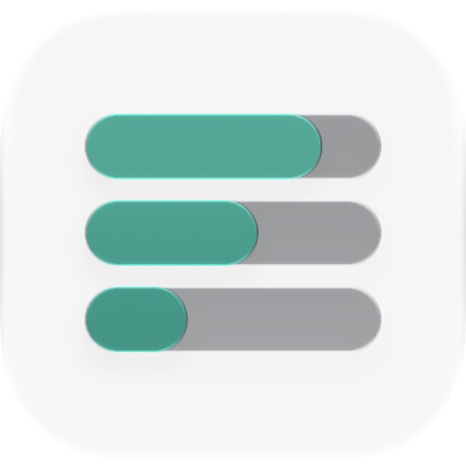
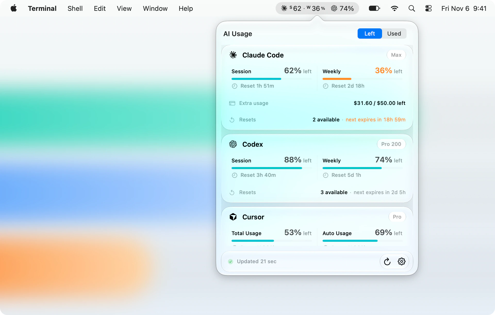
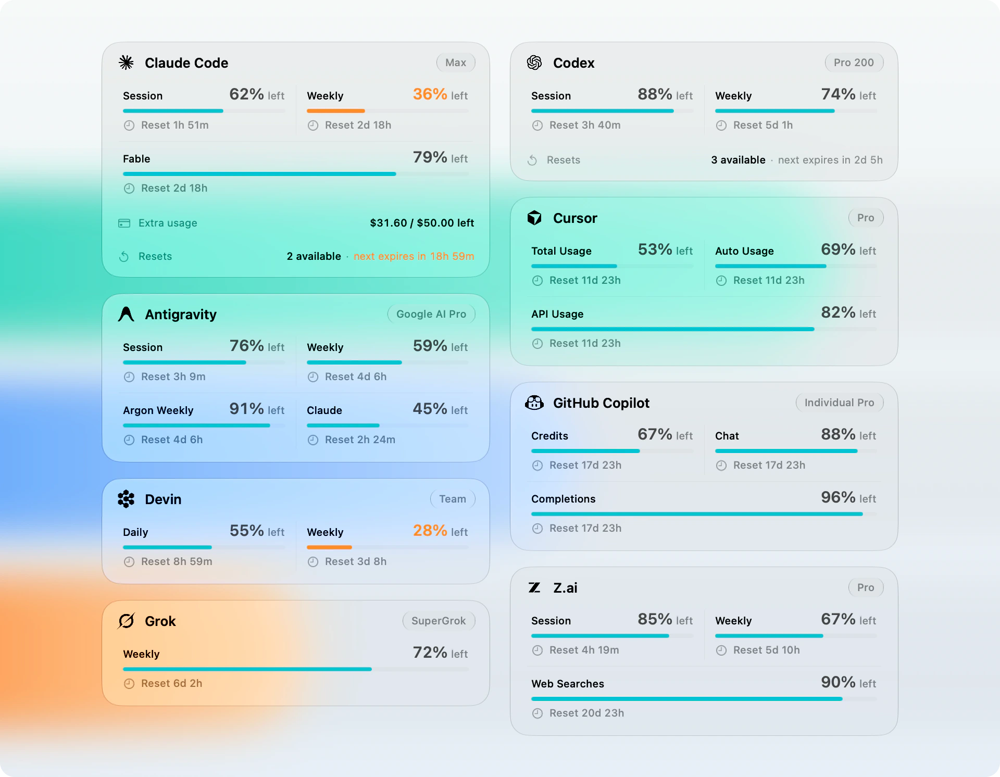
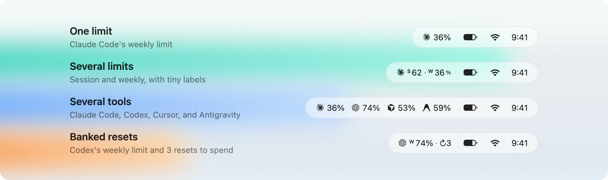
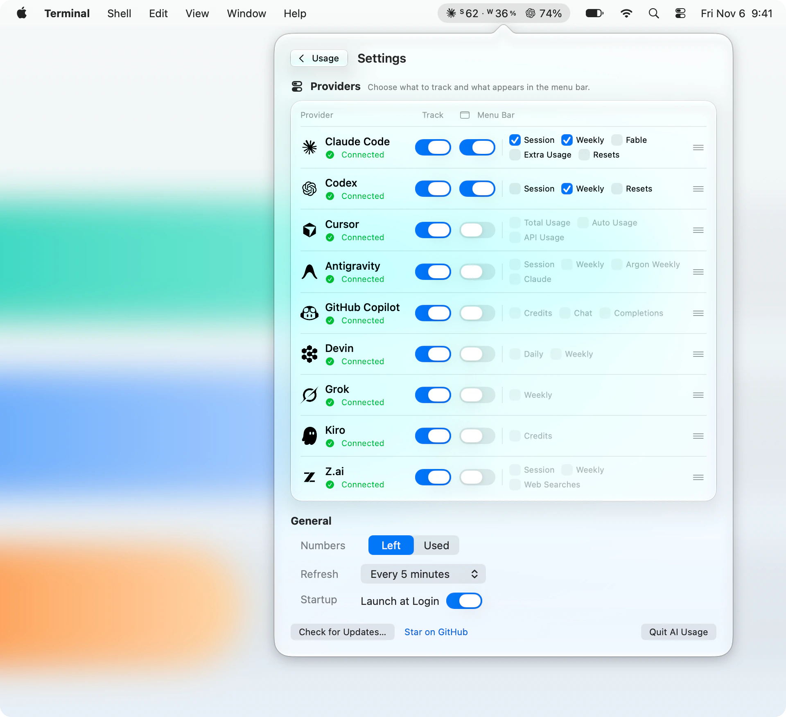

<p align="center">
  <picture>
    <source media="(prefers-color-scheme: dark)" srcset="docs/images/app-icon-dark.png">
    
  </picture>
</p>

<h1 align="center">AI Usage</h1>

<p align="center">
  <b>Every AI coding limit, right in your menu bar.</b><br>
  See how much of Claude Code, Codex, Cursor, Antigravity, GitHub Copilot,<br>
  Devin, Grok, Kiro, and Z.ai you have left, and when it resets.
</p>

<p align="center">
  <a href="https://github.com/burakgon/ai-usage-menubar/releases/latest"></a>
  <a href="https://github.com/burakgon/ai-usage-menubar/releases"></a>
  
  <a href="LICENSE"></a>
</p>

<p align="center">
  <a href="https://github.com/burakgon/ai-usage-menubar/releases/latest/download/AI-Usage.dmg"></a><br>
  <sub>Free and open source. Notarized by Apple.</sub>
</p>

<p align="center">
  <picture>
    <source media="(prefers-color-scheme: dark)" srcset="docs/images/hero-dark.webp">
    
  </picture>
</p>

Coding agents stop mid-task when a limit runs out. AI Usage keeps the numbers
one glance away: what's left of every session and weekly limit, when each one
resets, and how many banked resets you can still spend. It reuses the logins
your tools already have, so there is nothing to set up.

- **Nothing to set up.** No account, API key, or password. If you're signed in
  to a tool, AI Usage can read its limits.
- **Private.** It talks only to each provider's own usage endpoint. No
  analytics, no servers of ours, no usage history.
- **Light.** Measured at 0.0% CPU between refreshes. The panel is released as
  soon as it closes.
- **Native.** SwiftUI and Liquid Glass in light and dark, with signed automatic
  updates.

## Supported tools

<p align="center">
  <picture>
    <source media="(prefers-color-scheme: dark)" srcset="docs/images/providers-dark.webp">
    
  </picture>
</p>

| Tool | What you see | Where the login comes from |
| --- | --- | --- |
| **Claude Code** | Session, weekly, Sonnet, and Fable limits, extra usage in your billing currency, banked resets | Claude Code's saved login |
| **Codex** | Session, weekly, and Spark limits, credits, banked resets | Codex's ChatGPT login |
| **Cursor** | Total, Auto, and API usage, on-demand spend | Cursor's login |
| **Antigravity** | Gemini session and weekly limits, Argon, Claude pool | Antigravity's Google login, or the running app or `agy` |
| **GitHub Copilot** | Credits, chat, and completions | Copilot's editor sign-in or the GitHub CLI |
| **Devin** | Daily and weekly quota | Devin's login |
| **Grok** | Weekly quota | Grok CLI's login |
| **Kiro** | Credits, free-trial, session, weekly, and daily quota, overage spend | Kiro's or `kiro-cli`'s AWS SSO login, or `KIRO_API_KEY` |
| **Z.ai** | GLM Coding Plan session, weekly, and web search limits | The key Claude Code or OpenCode uses, or `ZAI_API_KEY` |

Only tools installed on your Mac get a card. A tool that's signed out stays
visible and tells you what to do.

## Choose what the menu bar shows

<p align="center">
  <picture>
    <source media="(prefers-color-scheme: dark)" srcset="docs/images/menubar-dark.webp">
    
  </picture>
</p>

Show any tool and any limit it reports. A single limit shows just its number,
several get tiny labels, and `↻3` counts the resets you have banked. Switch
between what's left and what's used right in the panel.

<p align="center">
  <picture>
    <source media="(prefers-color-scheme: dark)" srcset="docs/images/settings-dark.webp">
    
  </picture>
</p>

Track every tool you use and choose exactly what reaches the menu bar. Usage
refreshes every 1, 5, 15, 30, or 60 minutes, and the refresh button works any
time.

<details>
<summary><b>How the menu bar decides what to show</b></summary>

- **Weekly** is selected for Claude Code and Codex at first, and **Left** is
  the default number mode.
- When a selected limit is missing, such as Claude's session window on
  accounts that have none, the tool's default limit is shown instead.
- The panel lists when each banked reset expires and turns the next one orange
  in its final 24 hours.
- Percentages are shown exactly as the provider reports them. Only the bars are
  clamped to `0...100`, and a remaining percentage never goes below zero.

</details>

## Privacy

- AI Usage reads the credentials your tools already saved on this Mac. It never
  asks for a key, a password, or an account.
- Requests go only to each provider's own usage endpoint. There is no AI Usage
  server, analytics, or telemetry.
- Tokens are never printed, logged, or sent anywhere else.
- Kiro's stored AWS SSO token is refreshed through the client registration Kiro
  registered itself, never through another tool's registration in the same cache.
- It's read-only. Resets are shown but never redeemed, and nothing in your
  accounts changes.
- Usage lives in memory and isn't kept across launches. When a refresh fails,
  the last values stay visible and are marked stale.

The exact provider contracts are documented in
[docs/provider-contracts.md](docs/provider-contracts.md).

## Install

1. Download [AI-Usage.dmg](https://github.com/burakgon/ai-usage-menubar/releases/latest/download/AI-Usage.dmg).
2. Open it and drag **AI Usage** to Applications.
3. Launch it. AI Usage lives in the menu bar, not the Dock.

AI Usage needs macOS 26 or later and runs natively on Apple silicon and Intel.
Builds are signed with a Developer ID and notarized by Apple. Updates install
from the panel and are verified with Sparkle's EdDSA signatures.

## FAQ

<details>
<summary><b>Which plans work?</b></summary>

Whatever plan you're on. AI Usage shows the limits each provider reports for
your account and names the plan when the provider does.

</details>

<details>
<summary><b>Codex shows no usage.</b></summary>

Sign in to Codex with ChatGPT. API-key-only authentication can't read ChatGPT
subscription usage.

</details>

<details>
<summary><b>Why isn't <code>CLAUDE_CODE_OAUTH_TOKEN</code> used?</b></summary>

Setup tokens don't include the profile scope Claude's usage endpoint requires.
Sign in to Claude Code normally and AI Usage picks up that login.

</details>

<details>
<summary><b>Antigravity shows no quota.</b></summary>

Google doesn't share the quota of some accounts. Open Antigravity or run `agy`,
and AI Usage reads the quota from it instead.

</details>

<details>
<summary><b>Can I redeem a reset from AI Usage?</b></summary>

No. Resets are shown read-only. Redeem them in the provider's own app.

</details>

## Build from source

You need macOS 26 or later and Xcode 27 or later.

```bash
git clone https://github.com/burakgon/ai-usage-menubar.git
cd ai-usage-menubar
./scripts/install.sh
```

The script builds a Release version, installs it to
`~/Applications/AI Usage.app`, and opens it. To work on the app, open
`AIUsage.xcodeproj` and run the `AIUsage` scheme.

Run the tests with:

```bash
xcodebuild test \
  -project AIUsage.xcodeproj \
  -scheme AIUsage \
  -destination 'platform=macOS'
```

The app is SwiftUI and AppKit, with a small provider layer and an in-memory
store. Its only dependency is [Sparkle](https://github.com/sparkle-project/Sparkle),
for signed updates.

- `./scripts/render_readme_images.sh` renders the README images from the real
  views with made-up data.
- `./scripts/generate_app_icon.swift` regenerates the icon previews.
- [docs/releasing.md](docs/releasing.md) covers packaging and the update feed.

## Contributing

Bug reports, provider fixes, and pull requests are welcome. Please read
[CONTRIBUTING.md](CONTRIBUTING.md) first, and report security issues privately
as described in [SECURITY.md](SECURITY.md).

## Credits

Provider contracts and parts of the system-boundary implementation were adapted
from [OpenUsage](https://github.com/robinebers/openusage), using stable tag
`v0.7.6`, local language-server discovery from tag `v0.7.16`, and provider
updates through commit `fdf7a234b76b6a71522880cc9ab5b38044471698`. See
[NOTICE](NOTICE) for attribution. Provider names and marks belong to their
owners and don't imply endorsement.

## License

AI Usage is available under the [MIT License](LICENSE).

---

<p align="center">
  If AI Usage saves you a trip to the usage page, a
  <a href="https://github.com/burakgon/ai-usage-menubar/stargazers">star</a>
  helps other developers find it.
</p>

<p align="center">
  <a href="https://star-history.com/#burakgon/ai-usage-menubar&Date">
    <picture>
      <source media="(prefers-color-scheme: dark)" srcset="https://api.star-history.com/svg?repos=burakgon/ai-usage-menubar&type=Date&theme=dark">
      
    </picture>
  </a>
</p>
